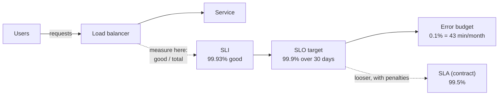

# Module 1: SLOs and error budgets

## Objectives

After this module you can:

- Explain SLI, SLO, SLA and error budget, and how they relate.
- Choose good SLIs for a request-driven service and for a platform.
- Calculate allowed downtime and failed requests for any target.
- Explain burn rate and why SLO alerts use two time windows.
- Write an error budget policy that a product team would sign.

## Why it matters

Without an agreed target, "is the service reliable?" has no answer. Every incident turns into an argument about whether it was bad, and every release into an argument about whether it's too risky. SLOs give you:

- **A shared definition of "good enough"**, written from the user's point of view.
- **A decision rule**: while the error budget lasts, ship; when it's spent, fix reliability first.
- **Better alerts**: you page when the budget is burning fast, not when a CPU graph looks scary (Module 3).

## The vocabulary



| Term | Meaning | Example |
|---|---|---|
| **SLI** (indicator) | A measurement of user experience, usually **good events / total events** | % of HTTP requests that return non-5xx in under 300 ms |
| **SLO** (objective) | A target for an SLI over a time window. Internal. | 99.9% over a rolling 30 days |
| **Error budget** | 100% minus the SLO: how much unreliability you can afford | 0.1% of requests, or 43 minutes a month |
| **SLA** (agreement) | A contract with customers, with penalties such as service credits | 99.5% monthly, or credits |

The SLA is always **looser** than the SLO, so you notice problems and fix them before you owe customers money.

## Choosing SLIs

Start from **what users do and what they'd complain about**, not from what's easy to measure.

| Service type | Typical SLIs |
|---|---|
| Request/response (API, website) | **Availability**: % of requests not failing (5xx, timeouts). **Latency**: % of requests faster than a threshold. |
| Pipeline / batch | **Freshness**: % of data updated within N minutes. **Correctness**: % of records processed correctly. **Coverage**: % of input processed. |
| Storage | **Durability**: data not lost. **Availability** of reads and writes. **Latency**. |
| Kubernetes platform (users are developers) | API server availability and latency; **pod start time** (% Ready within N seconds); deploy success rate; DNS success; for fleets: **% of clusters healthy**. |

Rules that save you from common mistakes:

- **Measure close to the user.** The load balancer or ingress sees errors your app never logs (a crashed pod, a bad route). Client-side measurement is even closer but noisier.
- **Use ratios of events**, not averages. "99.9% of requests succeeded" is meaningful; "average error rate was low" hides bad hours.
- **Latency is a threshold, not an average.** "99% of requests under 500 ms" captures the slow tail that averages hide.
- **Exclude traffic that isn't users**: health checks, metric scrapes, synthetic tests. In the lab you'll see probes in the same metric as real requests.
- **CPU, memory and pod restarts are never SLIs.** They are causes. Users feel symptoms.
- **Decide which errors count.** 5xx: always. 4xx: usually not (the client sent a bad request), but watch 429 (you're throttling real users) and 4xx spikes after a release (Module 4 shows a bug that returned 400s).

## Choosing the target

| SLO | Allowed bad time per 30 days | Allowed failures per 10 million requests |
|---|---|---|
| 99% | 7.2 hours | 100,000 |
| 99.5% | 3.6 hours | 50,000 |
| 99.9% | 43.2 minutes | 10,000 |
| 99.95% | 21.6 minutes | 5,000 |
| 99.99% | 4.3 minutes | 1,000 |

How to pick:

1. **Look at current performance** over the last 4 weeks. Setting a target you already miss every month just teaches people to ignore it.
2. **Check your dependencies.** Services called in series multiply: three dependencies at 99.9% each give at most 0.999 × 0.999 × 0.999 ≈ **99.7%**. You can't promise more than your weakest critical path allows, unless you add redundancy or fallbacks.
3. **Consider how fast you can react.** A 99.99% SLO allows 4 minutes a month. A human can't even acknowledge a page in that time, so that target needs automatic failover and rollback.
4. **Start a bit lower and tighten.** A new SLO is a hypothesis. Review it after a month: did the SLO burn when users actually complained? If not, the SLI is wrong.

## Error budgets and burn rate

The error budget is what you spend on releases, experiments, maintenance and bad luck. **Burn rate** says how fast you're spending it compared with the allowed pace:

- **Burn rate 1**: you'll use exactly the whole budget by the end of the window.
- **Burn rate 10**: you'll use it in a tenth of the time (3 days of a 30-day window).
- **Burn rate during a total outage** of a 99.9% SLO: 100% / 0.1% = **1,000**.

```text
burn rate = observed error ratio / (1 - SLO)
example:  2% errors with a 99.5% SLO  ->  0.02 / 0.005 = 4x
```

### Alerting on burn rate

The [Google SRE Workbook](https://sre.google/workbook/alerting-on-slos/) recommends **multi-window, multi-burn-rate** alerts. For a 30-day SLO:

| Severity | Burn rate | Long window | Short window | Meaning |
|---|---|---|---|---|
| Page | 14.4 | 1 hour | 5 minutes | 2% of the monthly budget gone in an hour |
| Page | 6 | 6 hours | 30 minutes | 5% gone in 6 hours |
| Ticket | 3 | 1 day | 2 hours | 10% gone in a day |
| Ticket | 1 | 3 days | 6 hours | slow leak: on track to spend everything |

Why two windows: the **long window** proves the problem is big enough to matter; the **short window** proves it's still happening, so the alert stops soon after you fix it. Module 3 goes deeper.

## The error budget policy

An SLO without a policy is just a graph. The policy is a short document, agreed **before** the next incident by engineering and product leadership:

```markdown
# Error budget policy: checkout

SLO: 99.5% of requests succeed, 99% under 500 ms, rolling 30 days.

- Budget remaining > 25%: release normally.
- Budget remaining < 25%: releases need a rollback plan and a canary; no risky experiments.
- Budget exhausted: feature releases stop. Only reliability fixes and security patches ship
  until the 30-day SLI is back above target. The top causes of budget burn go to the top of the backlog.
- Exceptions: outages caused by a dependency outside our control (with its own SLO) don't count against us;
  the VP Engineering can approve a one-time exception, recorded with the reason.
- Review: this SLO and policy are reviewed every quarter.
```

The point isn't punishment. It's that nobody has to argue during a crisis: the decision was made in advance.

## How the industry does it

- SLOs are defined per **critical user journey** (log in, search, check out), not for every microservice.
- Teams start with **one or two SLOs**, review them weekly in an ops meeting, and expand once the value is clear.
- Tools generate the Prometheus rules: [Sloth](https://sloth.dev) (used in the lab), [Pyrra](https://github.com/pyrra-dev/pyrra), [OpenSLO](https://openslo.com) as a vendor-neutral spec, and SLO features in most commercial observability platforms.
- Platform teams publish **platform SLOs** (API availability, pod start time) so application teams know what they can build on.

## Common mistakes

- Picking 99.99% because it sounds good, without the automation to defend it.
- SLIs measured on infrastructure (CPU, node up) instead of user experience.
- Counting health checks as traffic: a perfectly healthy probe stream hides real failures.
- Trusting "budget remaining" on a brand-new SLO: with 20 minutes of data, a 30-day calculation is meaningless (you'll see this in the lab).
- An SLO with no policy, so nothing changes when it's missed.

## Further reading

- [SRE Book: Service Level Objectives](https://sre.google/sre-book/service-level-objectives/)
- [SRE Workbook: Implementing SLOs](https://sre.google/workbook/implementing-slos/) and [Alerting on SLOs](https://sre.google/workbook/alerting-on-slos/)
- [Sloth documentation](https://sloth.dev)

**Next:** the [lab](lab.md): define SLOs for the checkout service and watch the budget burn.
