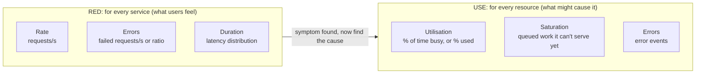

# Module 2: Observability

## Objectives

After this module you can:

- Explain the difference between monitoring and observability, and what metrics, logs and traces are each good at.
- Use the **RED** method for services and the **USE** method for resources, and know which one to start with.
- Write correct PromQL for rates, error ratios and latency percentiles, and avoid the classic histogram mistakes.
- Explain why averages hide user pain.
- Spot and stop a **cardinality** explosion before it takes Prometheus down.
- Lay out a service dashboard that gets on-call from "something's wrong" to "it's here" in a few clicks.

## Why it matters

Module 1 gave checkout an SLO, so you now know **when** users are hurting. Observability answers the next two questions, the ones on-call asks at 3 a.m.:

1. **What are users seeing?** Errors? Slowness? On every request or only some?
2. **Where is the problem?** Which endpoint, which pod, which dependency, which resource?

A team with good SLOs but poor observability gets paged correctly and then spends an hour guessing.

## Monitoring and observability

- **Monitoring** answers questions you thought of in advance: "is the error rate above 1%?" It's dashboards and alerts.
- **Observability** is how well you can answer questions you **didn't** think of in advance, from the data the system already emits: "why are only Android users in Brazil getting slow checkouts since 14:05?"

You need both. Monitoring tells you something's wrong; observability lets you find out why without shipping new code first.

## The signals

| Signal | What it is | Good at | Weak at | Lab tool |
|---|---|---|---|---|
| **Metrics** | Numbers over time, with labels | Cheap to keep for months; alerts; trends; "how much, how often" | Detail of a single request; high-cardinality questions (per user) | Prometheus |
| **Logs** | Timestamped records of events | The exact error message, the stack trace, "what happened to request X" | Expensive at volume; hard to aggregate unless structured | `kubectl logs` |
| **Traces** | The path of one request through every service, with timing per hop | "Which of the 12 services made this request slow?" | Usually sampled, so rare events can be missing | (not in this lab) |
| **Profiles** | Where CPU and memory go inside a process, down to the function | "Which function burns the CPU?" | Mostly per process, not per request | (not in this lab) |

The usual investigation flows **metrics → traces → logs**: a metric shows *that* p99 went up, a trace shows *which hop* is slow, and that service's logs show *why*. The links between them matter as much as the signals: **exemplars** attach a trace ID to a histogram bucket, and logs that include the trace ID let you jump straight from a slow trace to its log lines.

**OpenTelemetry** (OTel) is now the industry standard for producing all of these. You instrument the code once with OTel SDKs, run the OTel Collector, and send the data to whatever back end you use (Prometheus, Loki, Tempo, Jaeger or a commercial vendor).

## What to measure: golden signals, RED and USE

Google's SRE book names **four golden signals** for any user-facing system: **latency, traffic, errors and saturation**. Two methods make them practical:



**RED** (Tom Wilkie) is for **services**: anything that handles requests. It describes the user experience, so it's what your SLOs are built on.

**USE** (Brendan Gregg) is for **resources**: CPU, memory, disk, network, and also software resources such as connection pools, thread pools and queues. For each one, ask:

| Resource | Utilisation | Saturation | Errors |
|---|---|---|---|
| CPU (node) | % busy | run queue, load per CPU, CPU pressure (PSI) | — |
| CPU (container with a limit) | usage ÷ **limit** | **CFS throttling**: % of periods throttled | — |
| Memory | working set ÷ limit | memory pressure, swapping | **OOM kills** |
| Disk | % time busy | I/O wait, queue length | I/O errors |
| Network | bandwidth used | dropped packets, retransmits | interface errors |
| Connection pool | connections in use ÷ max | callers waiting for a connection | timeouts getting a connection |

Start with **RED** (it tells you users are affected and narrows down where), then use **USE** on the resources behind the affected part. Starting with USE leads to "CPU is at 85%, is that bad?" with no way to tell.

!!! warning "Utilisation must be measured against the right limit"
    A container with a CPU **limit** of 0.1 cores that uses 0.1 cores is at **100%**, even though the node is 90% idle. The kernel throttles it, and latency goes up. A node-level dashboard won't show it. You'll see this in the lab.

## Metric types and PromQL you need

| Type | What it does | Example | Query it with |
|---|---|---|---|
| **Counter** | Only goes up (resets to 0 when the process restarts) | `http_requests_total` | `rate()` or `increase()`, never the raw value |
| **Gauge** | Goes up and down | memory in use, queue length | the raw value, `avg_over_time()`, `max_over_time()` |
| **Histogram** | Counts observations in **buckets** (`_bucket{le="0.5"}`), plus `_sum` and `_count` | request duration | `histogram_quantile()` on `rate()` of the buckets |
| **Summary** | Quantiles calculated **in the app** | older Go/Java clients | the quantile series directly, but you **can't aggregate** them |

The patterns you'll write again and again:

```promql
# Rate: requests per second, over the last 5 minutes
sum(rate(http_request_duration_seconds_count{job="checkout"}[5m]))

# Errors: share of requests that failed
sum(rate(http_request_duration_seconds_count{job="checkout", status=~"5.."}[5m]))
  / sum(rate(http_request_duration_seconds_count{job="checkout"}[5m]))

# Duration: p99, across all pods
histogram_quantile(0.99, sum by (le) (rate(http_request_duration_seconds_bucket{job="checkout"}[5m])))
```

`rate()` handles counter resets for you. That's why you never graph a raw counter: after a pod restart the line drops to zero, and the drop means nothing.

### Percentiles, not averages

Latency is a **distribution**, and users experience its tail. If 95% of requests take 3 ms and 5% take 2 s:

| Statistic | Value | What it tells you |
|---|---|---|
| Average | about 100 ms | "Looks fine." It describes almost nobody: no request actually took 100 ms. |
| p50 (median) | 3 ms | Half the users are fine. |
| p99 | 2 s | 1 in 100 requests is awful. A user loading a page that makes 20 requests hits it about 1 time in 5. |

Rules for histograms:

1. **Aggregate the buckets, then take the quantile**: `histogram_quantile(0.99, sum by (le) (rate(..._bucket[5m])))`. Keep `le` in the `by ()` clause, plus any label you want to split by: `sum by (le, path)`.
2. **Never average percentiles.** The average of three pods' p99s isn't the service's p99. It can be badly wrong when one pod is slow and gets little traffic. Only buckets can be added up.
3. **The answer is an estimate**, interpolated between bucket boundaries. With buckets at 1 s and 2.5 s, a request that took 2.0 s can be reported as 2.48 s. Choose bucket boundaries around your SLO threshold. **Native histograms** in newer Prometheus versions have much finer, automatic buckets.
4. **Summaries can't be aggregated** across pods at all. Prefer histograms.

## Labels and cardinality

Every unique combination of metric name and label values is a separate **time series**. Prometheus keeps recent series in memory, so the number of series, the **cardinality**, drives its memory, CPU and cost.

```text
series = metrics × values of label 1 × values of label 2 × ...

http_request_duration_seconds_bucket for checkout:
  3 pods × 4 paths × 1 method × 1 status × 12 buckets   = 144 series     fine
  add user_id (100,000 users)                          = 14.4 million   Prometheus falls over
```

- **Good labels** have a small, bounded set of values: `status`, `method`, `path` **template** (`/users/:id`, not `/users/12345`), `region`, `pod`.
- **Bad labels** are unbounded: user ID, email, session ID, request ID, full URL, raw error message, timestamp.
- **Hidden multipliers**: histograms multiply everything by their bucket count, and pods that restart often (or autoscale) create new series each time (**churn**).
- If you need per-user or per-request detail, that's a job for **logs and traces**, not metrics.

Defences, from most to least effective:

1. **Review metrics in code review** like any other API.
2. **Limits on every scrape**: `sampleLimit` on a ServiceMonitor makes Prometheus reject a target that suddenly exposes too many series, instead of running out of memory.
3. **Watch the watcher**: alert on `prometheus_tsdb_head_series` growth, and check *Status → TSDB Status* in the Prometheus UI, which lists the metrics and labels with the most series.
4. **Drop at scrape time** with `metricRelabelings` as an emergency fix while the code is changed.

## Dashboards that help on-call

A good service dashboard reads **top to bottom, like an investigation**:

1. **Is it healthy?** SLO burn rates and firing alerts. One glance.
2. **What do users see?** RED: rate by status, error ratio, p50/p90/p99.
3. **Where?** The same RED panels split by endpoint, pod or zone.
4. **Why?** USE for the resources behind it: CPU against limit and throttling, memory against limit, restarts, dependency latency.

Habits that make dashboards trustworthy:

- **Dashboards as code** (JSON in Git, or generators such as Grafonnet), deployed like any other change, so they're reviewed and can't silently drift.
- **One dashboard per service with the same layout** for every service, so on-call doesn't have to learn a new one during an incident.
- **Units and thresholds on every panel**, and a description that says what "bad" looks like.
- **Fewer panels.** A 60-panel dashboard is a sign nobody knew which ones matter.

## How the industry does it

- **OpenTelemetry** for instrumentation, with the OTel Collector routing data to one or more back ends.
- **Prometheus-compatible** metrics almost everywhere. At scale, long-term storage moves to **Thanos**, **Mimir**, **Cortex** or **VictoriaMetrics**, or to a managed service.
- **Grafana** (or a vendor's UI) for dashboards; **Loki** or Elasticsearch/OpenSearch for logs; **Tempo** or **Jaeger** for traces.
- **Observability cost** is a real budget line. Platform teams set cardinality limits per team and show each team what its metrics cost.
- **Platform golden dashboards**: the platform team ships a standard RED + USE dashboard for every workload, so app teams get a useful view on day one.

## Common mistakes

- Graphing a raw counter, or using `rate()` on a gauge.
- Alerting on averages, or showing only the average latency.
- `histogram_quantile` without `sum by (le)`, or averaging percentiles across pods.
- Measuring container CPU against the node instead of against its limit.
- Putting user IDs, request IDs or full URLs in labels.
- Huge dashboards that nobody can read during an incident, with no SLO panel at the top.
- Logs that aren't structured or don't carry a trace ID, so they can't be linked to anything.

## Further reading

- [SRE Book: Monitoring distributed systems](https://sre.google/sre-book/monitoring-distributed-systems/) (the four golden signals)
- [Brendan Gregg: The USE method](https://www.brendangregg.com/usemethod.html)
- [Tom Wilkie: The RED method](https://grafana.com/blog/2018/08/02/the-red-method-how-to-instrument-your-services/)
- [Prometheus: Histograms and summaries](https://prometheus.io/docs/practices/histograms/) and [Naming and labels](https://prometheus.io/docs/practices/naming/)
- [OpenTelemetry documentation](https://opentelemetry.io/docs/)

**Next:** the [lab](lab.md): build RED and USE views for checkout, find a hidden CPU problem, and stop a cardinality explosion.
