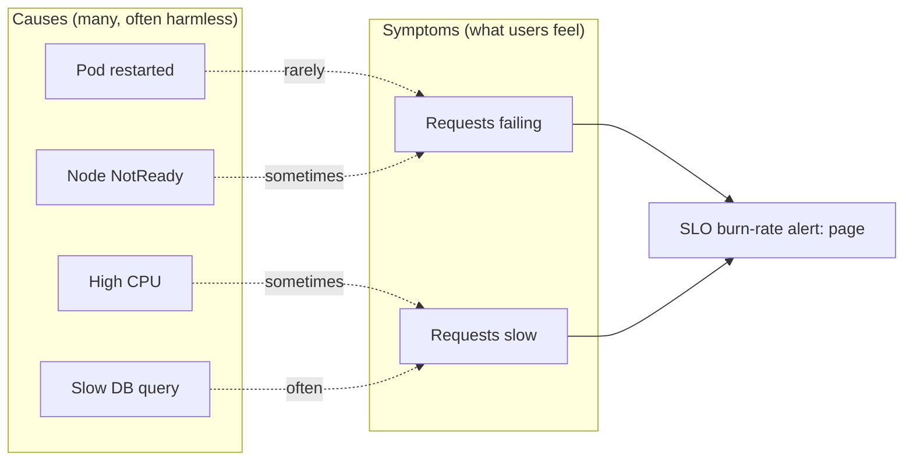
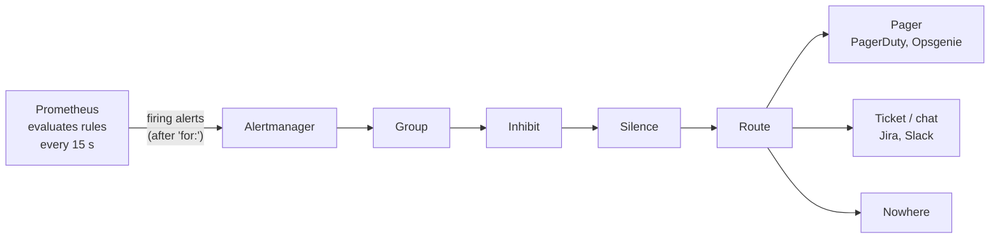

# Module 3: Alerting and on-call

## Objectives

After this module you can:

- Decide what deserves a **page**, what deserves a **ticket**, and what deserves nothing.
- Explain why good alerts are based on **symptoms** (the SLO) rather than causes.
- Read and change an Alertmanager **routing tree**, with grouping, inhibition and silences.
- Triage a noisy alert set, and measure alert quality.
- Write a **runbook** that a tired engineer can follow at 3 a.m.
- Describe a healthy on-call rotation: load, handover, escalation and compensation.

## Why it matters

Alerts are how reliability work reaches a human. Get them wrong in one direction and outages go unnoticed; get them wrong in the other and people get woken up for nothing until they start ignoring pages, which is worse. **Alert fatigue** is one of the most common reasons SRE teams burn out and quit, and one of the most common causes of slow incident response.

## What deserves a page

A page interrupts someone's sleep or weekend. Every page should pass all four tests:

1. **It's urgent**: users are affected now, or will be within hours if nobody acts.
2. **It's actionable**: there's something a human can do right now.
3. **It needs a human**: if a script could fix it, automate the fix instead.
4. **It's real**: it rarely fires when nothing is wrong.

Everything else is a **ticket** (someone looks during working hours) or **nothing** (it's on a dashboard for context, or it's deleted).

| Example | Page? | Why |
|---|---|---|
| Checkout is burning its 30-day budget at 14x | **Page** | Users are failing now; a few hours of this ruins the month |
| Checkout burning at 2x for a day | Ticket | Real, but there's time to fix it in working hours |
| A node's CPU is at 90% | Nothing | A cause, not a symptom. If users are affected, the SLO alert fires |
| One pod restarted | Nothing | Kubernetes already handled it. Repeated crash loops: a ticket |
| A TLS certificate expires in 14 days | Ticket | Urgent in two weeks, not tonight. Better: automate renewal |
| A TLS certificate expires in 2 hours | **Page** | Users will be affected soon, and it needs a human now |
| Disk fills up in 4 hours at the current rate | **Page** | Predictive, but the outage is near and certain |

## Symptoms, not causes

Cause-based alerts are tempting because they feel proactive. But most causes are harmless most of the time (Kubernetes reschedules pods, autoscalers add capacity), and you can never list every cause in advance. A symptom-based alert on the SLO catches **every** cause, including ones you didn't predict, and stays quiet when the system copes on its own.

Keep cause metrics on **dashboards** and in **runbooks**, where they help you find the problem after the SLO alert tells you there is one. Exceptions that are worth alerting on as causes: things that will certainly hurt users soon and can't be seen in the SLO yet (disk filling up, certificates expiring, a quorum about to be lost), and the monitoring system itself.

## The alerting pipeline

- **Prometheus** evaluates alert rules. An alert is **pending** until its condition has been true for the `for:` duration, then **firing**.
- **Alertmanager** decides who hears about it, and how often:
    - **Grouping** (`group_by`) puts related alerts into one notification. Fifty pods failing produce one page, not fifty.
    - `group_wait` (how long to wait for more alerts before the first notification), `group_interval` (how often to send updates about a group) and `repeat_interval` (how often to remind while it's still firing).
    - **Inhibition** mutes one alert while another is firing. For example: don't send the ticket for checkout while the page for checkout is firing, or don't alert on every service in a zone while the "zone down" alert fires.
    - **Silences** mute matching alerts for a set time: planned maintenance, or a known problem that's already being handled. Every silence needs an end time and a comment.
    - **Routing** sends each alert to a **receiver** based on its labels, usually `severity` and `team`.

### Labels make routing work

Alertmanager routes on labels, so every alert needs at least:

| Label | Values | Used for |
|---|---|---|
| `severity` | `page`, `ticket` (or `critical`, `warning`, `info`) | Page or ticket or nothing |
| `team` or `owner` | `shop-team`, `platform` | Which rotation gets it |
| `service` | `checkout` | Grouping and inhibition |

And these **annotations**, which humans read:

| Annotation | Content |
|---|---|
| `summary` | One line: what's wrong, in user terms |
| `description` | Current values, using template variables: `{{ $value }}`, `{{ $labels.pod }}` |
| `runbook_url` | A link to the [runbook](runbook-checkout.md) |
| `dashboard_url` | A link to the dashboard, already filtered to this service |

!!! warning "Default alert sets are a starting point, not a design"
    kube-prometheus-stack ships about 130 alert rules: around 30 `critical`, 90 `warning` and some `info`. They're written for a generic cluster. Decide for each **critical** one whether it pages **your** team, send `warning` to a ticket queue or chat, send `info` nowhere, and disable rules that can never be fixed in your environment. You'll do this in the lab.

## Watching the watcher

If Prometheus or Alertmanager is down, nothing pages, and the silence looks like good news. Two defences:

- **A dead man's switch**: an alert that **always** fires (kube-prometheus-stack's `Watchdog`), routed to an external service (such as Dead Man's Snitch, or PagerDuty or Opsgenie heartbeats) that pages you when the notifications **stop**.
- **Meta-monitoring**: a second, independent Prometheus (or a managed service) that alerts if the main one is down or can't reach Alertmanager.

## Runbooks

A runbook turns a page into a set of steps. Good runbooks:

- Start with **what to do in the first 5 minutes**: acknowledge, check it's real, check recent changes, roll back if they match.
- Contain **copy-paste commands and queries**, not prose about the architecture.
- Say **when to escalate**, and to whom.
- Are **linked from the alert** (`runbook_url`), so nobody has to search.
- Are **updated after every incident** where they were wrong or missing a step.

The [checkout runbook](runbook-checkout.md) is a complete example. If a runbook is just a list of commands that always fix the problem, that's a sign to **automate** it.

## On-call

| Practice | Why |
|---|---|
| **Rotations of 6-8 people**, one week each, primary and secondary | Fewer people means too much on-call per person; more means everyone forgets how |
| **Follow-the-sun** across time zones where the team allows | Nobody gets paged at night |
| **Load target**: at most about 2 incidents per 12-hour shift (Google's figure) | More than that leaves no time to fix causes, only symptoms |
| **Handover** at the end of each shift: what fired, what's still open | Context isn't lost between people |
| **Escalation policy**: if the primary doesn't acknowledge within 5-15 minutes, page the secondary, then the manager | Pages don't get lost |
| **Compensation**: pay or time off for on-call | Being on call is work, even on a quiet week |
| **Review every page** in a weekly ops meeting | Each non-actionable page gets fixed, tuned or deleted |

Useful alert quality measures for that review:

- **Pages per week** per rotation, and how many came at night.
- **Actionable rate**: the share of pages where someone actually did something. Aim for close to 100%.
- **Time to acknowledge** and **time to mitigate**.
- **Top noisy alerts**: the 5 alerts that sent the most notifications. Fix those first.

## How the industry does it

- **SLO burn-rate alerts** for paging, as in Module 1, generated by tools such as Sloth, Pyrra or a vendor's SLO feature.
- **PagerDuty, Opsgenie, incident.io, Grafana OnCall** and similar tools for schedules, escalation and acknowledgement. Alertmanager sends to them; it doesn't manage people.
- **Alert rules as code**, reviewed in pull requests, with unit tests (`promtool test rules`).
- **Routing by team label**, so platform teams can run one Alertmanager for many application teams.
- **Regular alert reviews**, with a rule that a page nobody acted on twice is changed or deleted.

## Common mistakes

- Paging on causes (CPU, memory, restarts) instead of symptoms.
- Leaving the default alert set as it is, so warnings and info alerts flood the ticket queue and nobody reads it.
- `for: 0m` on noisy conditions, so every blip notifies.
- No runbook link, or a runbook that's out of date.
- Silences with no end time or no comment.
- No dead man's switch, so a broken Alertmanager goes unnoticed.
- One person on call for weeks at a time.

## Further reading

- [SRE Book: Monitoring distributed systems](https://sre.google/sre-book/monitoring-distributed-systems/) and [Being on-call](https://sre.google/sre-book/being-on-call/)
- [Rob Ewaschuk: My philosophy on alerting](https://docs.google.com/document/d/199PqyG3UsyXlwieHaqbGiWVa8eMWi8zzAn0YfcApr8Q/)
- [Prometheus Alertmanager documentation](https://prometheus.io/docs/alerting/latest/alertmanager/)
- [kube-prometheus runbooks](https://runbooks.prometheus-operator.dev/)

**Next:** the [lab](lab.md): clean up a noisy alert set, follow a page through Alertmanager, and use the runbook.
