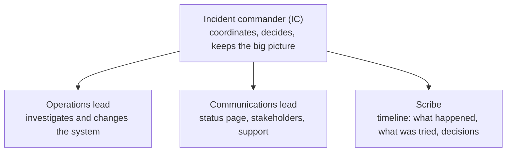

# Module 4: Incidents and postmortems

## Objectives

After this module you can:

- Decide when something is an **incident**, and how severe it is.
- Run an incident with clear **roles**: incident commander, operations, communications, scribe.
- Put **mitigation before diagnosis**, and know the standard mitigations.
- Write status updates that people outside engineering understand.
- Build an incident **timeline** from data, and write a **blameless postmortem** with useful action items.
- Plan and run a **game day**.

## Why it matters

Every service has incidents. What separates reliable teams is not that they have fewer, but that they **notice quickly, mitigate quickly, communicate clearly, and learn** so the same incident doesn't happen twice. Most of that is process, and process is something you can practise before you need it.

## What counts as an incident

An incident is an unplanned event that **hurts users, or is about to**, and needs a coordinated response. Declare one early: it's cheap to close an incident that turns out to be small, and expensive to coordinate a big one that nobody declared.

Most organisations use **severity levels** so everyone knows how big the response should be:

| Severity | Typical definition | Response |
|---|---|---|
| **SEV1** | Major user impact: core journey down for many users, data loss, security breach | Page immediately; incident commander; status page; leadership informed; updates every 15-30 minutes |
| **SEV2** | Significant impact: a feature down, or a core journey degraded for some users | Page; incident commander; updates every 30-60 minutes |
| **SEV3** | Minor impact or a workaround exists; or a near miss | Handle in working hours; still gets a short review |

Write the definitions down **in user terms** for your service (for example "checkout error ratio above 5% for 5 minutes is SEV2"). During an incident, nobody should argue about the severity; pick the higher one when unsure, and change it later.

## Roles

For anything bigger than a quick fix, split the work. One person doing everything is the most common reason incidents drag on.



| Role | Does | Doesn't |
|---|---|---|
| **Incident commander** | Sets the goal ("stop the errors"), assigns work, makes decisions, decides when to escalate and when it's over | Debug or type commands. The IC's hands stay off the keyboard. |
| **Operations lead** | Investigates, proposes and carries out mitigations, with others as needed | Talk to stakeholders |
| **Communications lead** | Writes updates for the status page, leadership and support, on a fixed schedule | Guess at causes in public |
| **Scribe** | Records times, findings, actions and decisions in the incident channel or document | Filter: write down everything, including dead ends |

In a small team, one person may hold two roles (IC + communications is common). The on-call engineer is usually the first IC, and hands over if someone more suitable joins.

**Handover** is explicit: "I'm handing IC to Priya. Current state: rollback done, errors down, watching for 15 minutes." Everyone in the channel should know who the IC is at all times.

## Mitigate first, then diagnose

The goal of incident response is to **stop user impact**, not to find the root cause. The root cause can wait for the postmortem; users can't.

Standard mitigations, in roughly the order to consider them:

| Mitigation | When |
|---|---|
| **Roll back** the latest change (code, config, feature flag, infrastructure) | A change happened shortly before the impact started. This is the most common cause, so check it first |
| **Turn off a feature flag** | The new code is behind a flag |
| **Drain** a bad zone, node or region | Impact is limited to one location |
| **Scale up** | Every instance is saturated and traffic grew |
| **Restart** | One instance is in a bad state (a leak, a stuck connection pool) |
| **Shed load or degrade** | Rate-limit, turn off non-essential features, serve cached data |
| **Fail over** | A dependency or the primary database is down |

**Roll back first, ask questions later.** If a change matches the start of the impact, roll it back, even if you're not sure it's the cause. A rollback that turns out not to help costs a few minutes; arguing about whether the change is the cause can cost an hour.

## Communication

Updates go out on a **fixed schedule** (every 15-30 minutes for a SEV1), even when there's no news. "No change, still investigating, next update at 14:45" is useful; silence makes people start their own investigations and flood the channel.

A good external update answers: **what's affected, what users should do, when the next update is.** It doesn't speculate about causes.

```text
[Investigating] 14:08 UTC
Some customers are seeing errors when checking out. We're investigating.
Orders already placed are not affected. Next update by 14:30 UTC.

[Mitigated] 14:15 UTC
We've rolled back a recent change and checkout errors have stopped.
We're monitoring to confirm. Next update by 14:45 UTC.

[Resolved] 14:45 UTC
Checkout has been working normally since 14:11 UTC. Between 14:02 and 14:11,
about 13% of checkout attempts failed. Customers can retry their orders.
We'll publish a summary of what happened and what we're changing.
```

Internal updates (to leadership and support) add the **business impact**, the current hypothesis and the next step.

## The postmortem

After every significant incident, write a **postmortem** (also called an incident review or post-incident report). Its purpose is learning: making sure this incident, and others like it, don't happen again.

### Blameless

A **blameless** postmortem assumes that everyone acted reasonably, given what they knew at the time. It asks **"what made this possible?"**, not "who did this?".

This isn't about being kind. It's practical: if people are blamed, they hide information, and the organisation stops learning. "Engineer ran the wrong command" leads to "be more careful". "The tool let a production command run without confirmation, in a terminal that looked the same as staging" leads to a fix.

### What goes in it

Use the [postmortem template](postmortem-template.md). The key sections:

- **Impact**: who was affected, how, for how long, and how much **error budget** it used. That number connects the incident to the SLO policy from Module 1.
- **Timeline**: built from **data** (alerts, deploys, metrics, chat logs), not memory. Include what people believed at each point, including wrong guesses.
- **Contributing factors**: there's rarely a single root cause. Look at the trigger, why it wasn't caught earlier, and why it lasted as long as it did.
- **Action items**: specific, with an owner and a due date, tracked in the normal backlog.

### Good action items

| Weak | Strong |
|---|---|
| "Be more careful when deploying" | "Add a canary stage that stops the rollout if the error ratio rises above 1%" |
| "Improve monitoring" | "Count 4xx responses caused by our own validation bugs in the availability SLI" |
| "Investigate the database" | "Add a connection-pool saturation panel to the checkout dashboard" |
| "Fix the bug" (only) | "Fix the bug" **and** "add a test for this case" **and** "make rollback the first step in the runbook" |

Prefer actions that **prevent** the problem or **limit its impact** (canaries, automation, guardrails) over actions that rely on people remembering.

### After the postmortem

- **Review** it in a meeting with the people involved and a few outside the team.
- **Share** it widely. Many companies publish an internal postmortem newsletter; some publish externally.
- **Track** the action items to completion. A postmortem whose actions are never done is just a story.
- Look for **patterns** across postmortems every quarter: the same contributing factor appearing again is the most valuable thing to fix.

## Game days

A **game day** is a planned exercise where the team breaks something on purpose, in a controlled way, and practises the response. It tests the alerts, the runbooks, the tools and the people.

1. **Plan**: choose a scenario, decide what "success" looks like (the page fires within 5 minutes; rollback within 10), and set a stop condition.
2. **Run it**: one person injects the fault; the on-call team responds as in a real incident, with roles.
3. **Review**: write a short postmortem. Game days almost always find something broken: a missing alert, a wrong runbook step, a permission nobody had.

Start in a test environment. Mature teams also run game days in production, with care. Module 9 covers chaos engineering, which is the automated version of this.

## How the industry does it

- **Incident management tools** (incident.io, PagerDuty, FireHydrant, Rootly, Jira Service Management) create the channel, page the roles, keep the timeline and generate the postmortem draft.
- **Status pages** (Atlassian Statuspage, instatus, or self-hosted) for external communication.
- Many companies base their process on the **Incident Command System** used by emergency services, adapted by Google, PagerDuty and others.
- **Postmortem reviews** are a regular meeting, and SEV1 postmortems often go to senior leadership.
- **Error budget policy** (Module 1) connects incidents to priorities: a big incident that spends the budget pauses feature work.

## Common mistakes

- Not declaring an incident because "it might be nothing", then losing 30 minutes.
- Everyone debugging, nobody coordinating or communicating.
- Searching for the root cause while users are still affected, instead of rolling back.
- No updates for an hour because "there's nothing new to say".
- A timeline written from memory a week later.
- Postmortems that blame a person, or end with "be more careful".
- Action items without owners, never finished.

## Further reading

- [SRE Book: Managing incidents](https://sre.google/sre-book/managing-incidents/) and [Postmortem culture](https://sre.google/sre-book/postmortem-culture/)
- [SRE Workbook: Incident response](https://sre.google/workbook/incident-response/)
- [PagerDuty incident response documentation](https://response.pagerduty.com/)
- [Etsy: Blameless postmortems and a just culture](https://www.etsy.com/codeascraft/blameless-postmortems)

**Next:** the [lab](lab.md): a game day with a bad release, and a postmortem written from the data.
