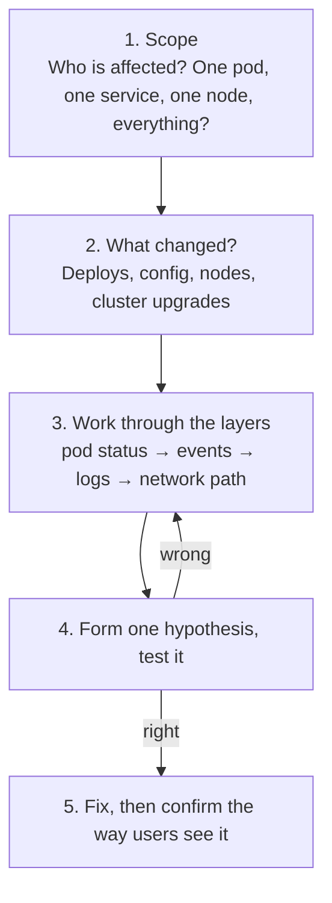
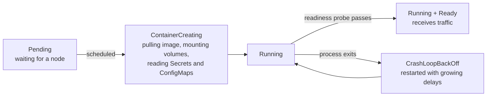
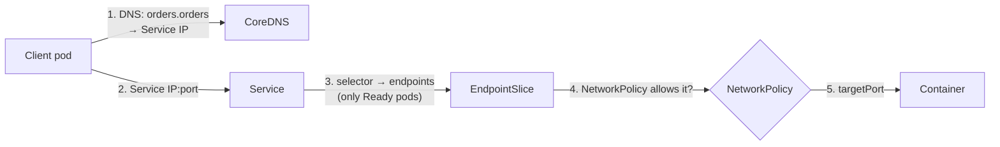

# Module 5: Troubleshooting Kubernetes

## Objectives

After this module you can:

- Troubleshoot methodically: scope the problem, check for changes, then work through the layers in order.
- Explain the pod lifecycle and what each failure state (`ImagePullBackOff`, `CrashLoopBackOff`, `OOMKilled`, `Pending`, `CreateContainerConfigError`, `Running` but not Ready) tells you.
- Follow a request from a client to a container and find where it stops: DNS, Service, endpoints, NetworkPolicy, readiness.
- Use `kubectl` efficiently to find the evidence: events, `describe`, logs (including the previous container's), endpoints.
- Recognise failures that your service's own metrics can't see.

## Why it matters

Platform and SRE teams spend a large part of every week answering "my service doesn't work on Kubernetes". The difference between a 5-minute answer and a 2-hour one is rarely knowledge of an obscure flag. It's **method**: knowing where to look first, and not guessing.

## The method



1. **Scope** first. One pod failing is a different problem from every pod in a namespace, or every namespace on one node. `kubectl get pods -A -o wide | grep -v Running` is a quick start.
2. **What changed?** As in Module 4, most problems follow a change: a deploy (`kubectl rollout history`, `helm history`), a config change, a node upgrade. If something changed at the right time, it's the first suspect.
3. **Work through the layers** in order, from the pod outwards. Don't skip to "it's probably the network".
4. **One hypothesis at a time.** Change one thing, check the result. Changing three things at once leaves you not knowing which one worked, or which one broke something else.
5. **Confirm the fix the way users see it**: a request from the caller's side, not just a green pod.

## The pod lifecycle



Each failure state points to a different layer:

| What you see | What it means | Where to look |
|---|---|---|
| `Pending` | No node can take the pod: not enough CPU or memory **requested** capacity, taints, node selectors or affinity, or an unbound volume | `kubectl describe pod` → **Events**: `FailedScheduling` says exactly why |
| `ErrImagePull`, `ImagePullBackOff` | The image can't be pulled: wrong name or tag, private registry without credentials, registry down or rate-limited | `describe pod` → Events: the registry's error message |
| `CreateContainerConfigError` | A referenced Secret, ConfigMap or key doesn't exist | `describe pod` → Events |
| `CrashLoopBackOff` | The process starts and exits, again and again | `kubectl logs <pod> --previous`: the **previous** container's output, where the error is |
| `OOMKilled` (exit code 137) | The container used more memory than its **limit**, and the kernel killed it | `describe pod` → **Last State**; memory usage against the limit (Module 2) |
| `Running` but `0/1` Ready | The readiness probe fails: wrong path or port, slow start, or a dependency is down. **No traffic is sent to it** | `describe pod` → Events: `Readiness probe failed` with the HTTP status or error |
| `Running`, `1/1`, but callers get errors or time out | The problem is between the caller and the pod | The network path, below |

!!! tip "Events are the fastest clue, and they expire"
    `kubectl describe pod` shows the pod's recent **events** at the bottom, and `kubectl get events -n <ns> --sort-by=.lastTimestamp` shows them for a whole namespace. Kubernetes keeps events for about **one hour** only. For an incident, collect them early, or ship them to your logging system.

## The network path

When pods are healthy but callers still fail, follow the request:



| Step | Check | Common problems |
|---|---|---|
| 1. DNS | `kubectl exec <client> -- nslookup orders.orders` (or `getent hosts`) | Wrong name or namespace; CoreDNS down or overloaded |
| 2. Service | `kubectl get svc -n orders` | Wrong `port`; wrong Service type |
| 3. Endpoints | `kubectl get endpointslices -n orders` | **Empty**: the selector doesn't match the pod labels, or no pod is Ready |
| 4. NetworkPolicy | `kubectl get networkpolicy -n orders` | A default-deny policy without an allow rule for this caller |
| 5. Container | `kubectl exec` into the pod and call `localhost:<port>` | `targetPort` doesn't match the port the process listens on |

The symptom helps narrow it down from the client side:

| Client error | Usually means |
|---|---|
| `Could not resolve host` | DNS (step 1) |
| `Connection refused` | Nothing listening: no endpoints, or the wrong port (steps 3, 5) |
| **Timeout** | Packets dropped: NetworkPolicy, or a node or network problem (step 4) |
| HTTP 5xx | You reached the application; it's an application problem |

## Failures your metrics can't see

checkout's SLO in Module 1 is measured **by the service itself**. That works for errors it returns, but some failures never reach it:

- **DNS failures**: callers can't find the service, so no request arrives. The service sees traffic drop to zero, with **no errors**.
- **NetworkPolicy and network drops**: requests time out before they arrive.
- **A load balancer or ingress problem** in front of the service.
- **Crashing pods** that never start: no metrics at all.

Defences:

- Watch **traffic** as well as errors: a sudden drop in request rate is a symptom (it's one of the four golden signals).
- Measure where users are: at the **ingress or load balancer**, or with **client-side** metrics.
- Run **synthetic probes** (for example Prometheus's blackbox exporter) that call the service the way a user would, from outside.
- Alert on **absent data**: `absent(up{job="checkout"})` or a rule that fires when the request rate is unexpectedly zero.

## Useful commands

```bash
# What isn't healthy, anywhere?
kubectl get pods -A -o wide | grep -v -E 'Running|Completed'
kubectl get events -A --sort-by=.lastTimestamp | tail -20

# One pod in detail
kubectl describe pod <pod> -n <ns>                 # status, last state, events
kubectl logs <pod> -n <ns> --previous              # the crashed container's output
kubectl get pod <pod> -n <ns> -o yaml              # the full spec, as the cluster has it

# What changed?
kubectl rollout history deploy/<name> -n <ns>
kubectl diff -f <file>                             # local file against the live object

# The network path
kubectl get svc,endpointslices -n <ns>
kubectl get networkpolicy -n <ns>
kubectl run tmp --rm -it --image=curlimages/curl:8.17.0 --restart=Never -- sh   # a throwaway client
```

`kubectl top pods` needs metrics-server, which the lab cluster doesn't have; use the Module 2 dashboard instead.

## How the industry does it

- **Standard debugging runbooks** per failure state, linked from alerts such as `KubePodCrashLooping` and `KubePodNotReady` (the kube-prometheus runbooks are a good start).
- **Ephemeral debug containers** (`kubectl debug`) for images that contain no shell.
- **Policy checks before deploy** (Kyverno, OPA Gatekeeper, `kubeconform`) catch many of these mistakes in CI: missing limits, `latest` tags, selectors that don't match.
- **Events and audit logs shipped** to the logging system, so they outlive the one-hour retention.
- Platform teams publish a **"why is my pod not running?"** guide and office hours, which saves far more time than answering each case.

## Common mistakes

- Deleting and recreating pods hoping it helps, before reading the events.
- Reading `kubectl logs` of the **new** container in a crash loop (empty) instead of `--previous`.
- Assuming "Running" means "working": a pod can be Running and not Ready, or Ready and unreachable.
- Checking the pods but never the Service's endpoints.
- Testing from inside the pod (`localhost` works) and concluding the network is fine.
- Changing several things at once.

## Further reading

- [Kubernetes: Debug pods](https://kubernetes.io/docs/tasks/debug/debug-application/debug-pods/) and [Debug Services](https://kubernetes.io/docs/tasks/debug/debug-application/debug-service/)
- [Kubernetes: Pod lifecycle](https://kubernetes.io/docs/concepts/workloads/pods/pod-lifecycle/)
- [A visual guide on troubleshooting Kubernetes deployments](https://learnk8s.io/troubleshooting-deployments)
- [kube-prometheus runbooks](https://runbooks.prometheus-operator.dev/)

**Next:** the [lab](lab.md): eight broken services and a DNS outage.
