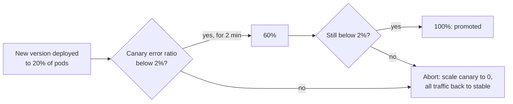
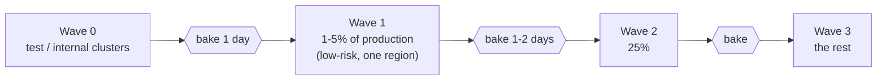

# Module 7: Safe change

## Objectives

After this module you can:

- Explain why **change** causes most incidents, and what "progressive delivery" means.
- Configure a Kubernetes **rolling update** safely (readiness, `maxSurge`, `maxUnavailable`, PodDisruptionBudgets).
- Compare **rolling**, **blue-green** and **canary** releases, and **feature flags**.
- Build a canary with **automated analysis** that rolls back on its own when the SLI gets worse.
- Roll out changes across a **fleet** of clusters in waves, with bake time.
- Handle the changes that can't simply be rolled back: database schemas and data.

## Why it matters

In Module 4, release 2 hit **every** user at once, and nobody was told for 45 minutes. Industry data (Google's SRE book, and most companies' own postmortem statistics) agrees that around **70%** of outages are caused by changes: deploys, configuration, infrastructure. You can't stop changing things, so make each change **small, gradual, observed and reversible**.

| Property | What it means | Why |
|---|---|---|
| **Small** | One logical change per release | Easy to understand, test and roll back; easy to find when it breaks |
| **Gradual** | First to a few users, then more | A bad change hurts 5% of users, not 100% |
| **Observed** | The SLI is checked at each step, automatically | Problems are caught in minutes, not when a customer calls |
| **Reversible** | Rollback is one command or automatic | Mitigation in seconds (Module 4) |

## Rolling updates

A Kubernetes Deployment replaces pods a few at a time:

```yaml
spec:
  strategy:
    rollingUpdate:
      maxSurge: 25%          # up to 25% extra pods during the update
      maxUnavailable: 0      # never fewer Ready pods than desired
  minReadySeconds: 10        # a new pod must stay Ready for 10 s before it counts
  template:
    spec:
      containers:
        - readinessProbe: ...           # without it, "Running" counts as ready
      terminationGracePeriodSeconds: 30 # time to finish in-flight requests
```

It's safe only if:

- The **readiness probe** really reflects whether the pod can serve (Module 5).
- The application handles **SIGTERM** gracefully: stops accepting new requests, finishes the current ones. Kubernetes removes the pod from endpoints and sends SIGTERM at about the same time, so a short `preStop` sleep (a few seconds) avoids dropped requests.
- A **PodDisruptionBudget** stops voluntary disruptions (node drains, cluster upgrades) from taking down too many pods at once.

A rolling update protects you from **crashing** pods (the rollout stops if new pods never become Ready). It does **not** protect you from pods that are Ready but **wrong**: returning errors, being slow, or computing bad results. Module 4's release 2 rolled out perfectly.

## Release strategies

| Strategy | How | Good for | Cost |
|---|---|---|---|
| **Rolling** | Replace pods gradually | Most changes; the default | No automatic quality check; every user gets the new version within minutes |
| **Blue-green** | Run the new version alongside the old, switch all traffic at once, keep the old for fast switch-back | Fast, complete rollback; testing the new version before it takes traffic | Twice the capacity during the release; the switch is all-or-nothing |
| **Canary** | Send a small share of traffic to the new version, compare its SLI with the old, increase step by step | Catching problems that tests miss, with a small blast radius | Needs good metrics per version, and enough traffic to be meaningful |
| **Feature flags** | Ship the code turned off; turn it on for some users, at runtime | Separating deploy from release; instant "rollback" without a deploy | Flag management; old flags become technical debt |

These combine: most mature teams ship with **canary deploys**, and turn on risky features with **flags**.

### Canary analysis

The canary is only useful if something **checks** it. Manual checks ("look at the dashboard for 10 minutes") get skipped under pressure. Automated analysis compares the canary's metrics with a threshold, or with the stable version, at each step:



What to measure: the **same SLIs** as the SLO (error ratio, latency), for the **canary pods only**. In the lab, Prometheus metrics carry the pod-template hash, so a query can select just the new version.

Weight on its own (20% of pods) is approximate. With a **service mesh** or an ingress controller that supports it (Istio, Linkerd, NGINX, Gateway API), canaries can use exact traffic percentages, or route specific users (employees first, one region first).

Tools: **Argo Rollouts** (used in the lab) and **Flagger** on Kubernetes; Spinnaker with Kayenta for statistical canary analysis; cloud deployment services offer similar features.

## Fleet rollouts

Platform teams change many clusters: Kubernetes upgrades, CNI or ingress versions, policies, platform add-ons. The same principles apply at a larger scale:



- **Waves (rings)** with growing size, starting with clusters where problems hurt least.
- **Bake time** between waves, long enough for slow problems (memory leaks, daily batch jobs) to show up.
- **Automated health gates**: each wave proceeds only if the platform SLOs (API server availability, pod start time, error rates of workloads) are healthy in the previous wave.
- **Stop on failure**, and make sure rollback (or roll forward) is tested before you need it.
- **Never all regions at once.** The largest cloud outages of recent years were global configuration changes pushed everywhere in minutes.

Tools: GitOps with Argo CD **ApplicationSets** (progressive syncs), Flux, Cluster API for cluster lifecycle, or an internal rollout orchestrator.

## Changes you can't roll back

Rolling back code is easy. Rolling back **data** isn't.

- **Database schema changes**: use **expand and contract**. First add the new column or table (expand), deploy code that writes both and reads either, migrate the data, deploy code that only uses the new schema, and only then remove the old column (contract). Every step can be rolled back on its own.
- **Data migrations and deletions**: back up first, migrate in batches, keep the old data until you're sure.
- **External effects**: emails sent, payments taken, messages published. Put them behind flags, and test with a small share first.

When rollback isn't possible, **roll forward** with a fix, but only with a small, well-understood change, and with the same canary process.

## Change and the error budget

The error budget (Module 1) connects release speed to reliability:

- Budget available: release normally, with canaries.
- Budget nearly spent: smaller releases, longer bake times, more manual checks.
- Budget exhausted: freeze feature releases; only reliability fixes ship.

Many companies also have **change freezes** around peak business periods (for example the end of the year for retail). They're a blunt tool: a good canary process reduces the need for them.

## How the industry does it

- **Progressive delivery** by default: every production deploy is a canary with automated analysis; humans step in only when it fails.
- **Deploy many times a day**, in small changes. Large, infrequent releases are riskier, not safer.
- **GitOps** (Argo CD, Flux): the desired state is in Git, every change is a reviewed commit, and rollback is a revert.
- **Feature flag platforms** (LaunchDarkly, Unleash, OpenFeature-based tools).
- **Fleet waves** for platform changes, with bake times and automated gates on platform SLOs.
- **Deploy annotations on dashboards**, so every graph shows when changes happened (Module 4's action item).

## Common mistakes

- Canaries with no automated analysis: someone has to remember to look.
- Analysis on the **whole service**: the canary's errors are diluted by 80% stable traffic, and nothing triggers.
- Too little traffic, or too short a step, for the metrics to mean anything.
- Readiness probes that pass before the application is really ready, so the rollout "succeeds" while requests fail.
- Pushing a configuration change to every region at once, because "it's only config".
- Schema changes that the previous code version can't work with, so rollback breaks.

## Further reading

- [SRE Book: Release engineering](https://sre.google/sre-book/release-engineering/)
- [SRE Workbook: Canarying releases](https://sre.google/workbook/canarying-releases/)
- [Argo Rollouts documentation](https://argo-rollouts.readthedocs.io/)
- [Kubernetes: Deployments, rolling updates](https://kubernetes.io/docs/concepts/workloads/controllers/deployment/#rolling-update-deployment)
- [Martin Fowler: Feature toggles](https://martinfowler.com/articles/feature-toggles.html) and [Parallel change (expand and contract)](https://martinfowler.com/bliki/ParallelChange.html)

**Next:** the [lab](lab.md): ship Module 4's bad release again, this time as a canary that rolls itself back.
